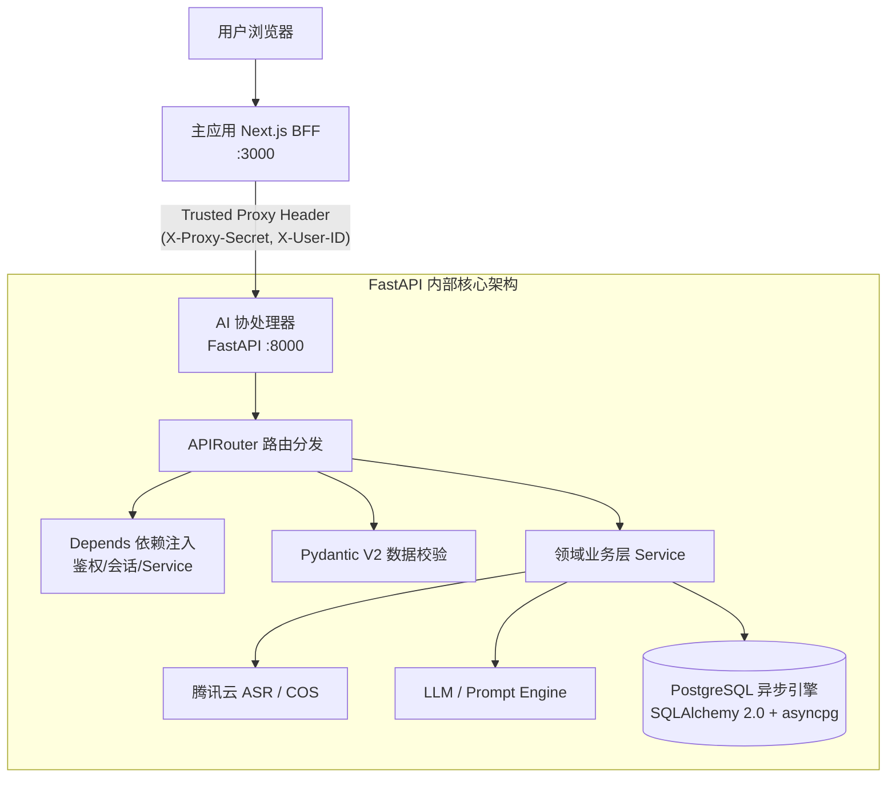

# 架构审计报告：FastAPI / Django 选型与现有工作证据

> **文档归档路径**: `/docs/agents/fastapi_django_architecture_audit.md`  
> **归档时间**: 2026-10-27  
> **审计对象**: 爆款解构器 (Viral Hit Deconstructor) 全仓技术栈

---

## 1. 核心核实结论

| 技术栈 | 结论 | 证据等级 | 简述 |
| :--- | :--- | :--- | :--- |
| **Django** | **未引入 / 0 痕迹** | 确凿（全仓 0 匹配） | 全仓库未检索到任何 Django 配置文件、依赖包或代码引入。 |
| **FastAPI** | **核心生产基础** | 确凿（生产级完整实现） | 作为独立子系统 `11-baokuan-jieqouqi-ai`，承担 AI 协处理器与重计算核心，包含路由、Pydantic V2 契约、依赖注入、异步 SQLAlchemy 2.0、测试与容器编排。 |

---

## 2. 系统整体架构全景

本项目采用 **Monorepo (主应用 + AI协处理器)** 架构：
- **主应用 (`10-baokuan-jieqouqi-web`)**: Next.js 15 (React 18 + Prisma)，负责终端交互、用户鉴权（Logto）以及轻量级业务 CRUD。
- **AI 协处理器 (`11-baokuan-jieqouqi-ai`)**: **FastAPI (Python 3.11/3.13)**，专注大模型驱动、音视频解析（FFmpeg/ASR）、Prompt 编排与脚本生成算法。
- **服务部署编排 (`12-baokuan-jieqouqi-deploy`)**: Docker Compose 将两者分立容器化协同。

---

## 3. 现有 FastAPI 关键工作证据链

### 3.1 依赖定义与运行环境
- **配置文件**: [`11-baokuan-jieqouqi-ai/requirements.txt`](file:///Users/liumingwei/01-project/12-liumw/09-baokuan-jieqouqi/11-baokuan-jieqouqi-ai/requirements.txt)
  - `fastapi==0.115.13`
  - `uvicorn==0.34.3`
  - `starlette==0.46.2`
  - `pydantic==2.11.7`
  - `pydantic-settings==2.5.2`
  - `sqlalchemy==2.0.32` + `asyncpg==0.29.0`

### 3.2 服务入口与生命周期管理
- **代码文件**: [`11-baokuan-jieqouqi-ai/app/main.py`](file:///Users/liumingwei/01-project/12-liumw/09-baokuan-jieqouqi/11-baokuan-jieqouqi-ai/app/main.py)
  - 使用现代 FastAPI 推荐的 `@asynccontextmanager lifespan` 管理启停资源；
  - 注册 `CORSMiddleware`；
  - 配置全局异常拦截器 `@app.exception_handler(APIException)`、`RequestValidationError` 与未捕获系统异常，统一输出结构；
  - 自动挂载 OpenAPI `/docs` 与 `/redoc`。

### 3.3 模块化路由注册 (`APIRouter`)
- **路由聚合入口**: [`11-baokuan-jieqouqi-ai/app/api/v1/api.py`](file:///Users/liumingwei/01-project/12-liumw/09-baokuan-jieqouqi/11-baokuan-jieqouqi-ai/app/api/v1/api.py)
  - `/api/v1/analyze`: 基础分析接口（[`app/api/v1/endpoints/analyze.py`](file:///Users/liumingwei/01-project/12-liumw/09-baokuan-jieqouqi/11-baokuan-jieqouqi-ai/app/api/v1/endpoints/analyze.py)）
  - `/api/v1/analysis`: 统一重构解构分析（[`app/api/v1/endpoints/unified_analysis.py`](file:///Users/liumingwei/01-project/12-liumw/09-baokuan-jieqouqi/11-baokuan-jieqouqi-ai/app/api/v1/endpoints/unified_analysis.py)）
  - `/api/v1/prompts`: Prompt 模板管理（[`app/routers/prompts.py`](file:///Users/liumingwei/01-project/12-liumw/09-baokuan-jieqouqi/11-baokuan-jieqouqi-ai/app/routers/prompts.py)）
  - `/api/v1/scripts`: 脚本管理与生命周期控制（[`app/routers/script_management.py`](file:///Users/liumingwei/01-project/12-liumw/09-baokuan-jieqouqi/11-baokuan-jieqouqi-ai/app/routers/script_management.py)）

### 3.4 依赖注入 (FastAPI `Depends`) 与鉴权设计
- **代码文件**: [`app/routers/script_management.py`](file:///Users/liumingwei/01-project/12-liumw/09-baokuan-jieqouqi/11-baokuan-jieqouqi-ai/app/routers/script_management.py#L63-L73)
  - 使用 `Depends(require_auth)` 校验上游代理凭证；
  - 使用 `Depends(get_script_service)` 实现 Service 层的控制反转。

### 3.5 前后端代理调用证据 (Next.js -> FastAPI)
- **前端代码**: [`10-baokuan-jieqouqi-web/src/app/api/v1/scripts/route.ts`](file:///Users/liumingwei/01-project/12-liumw/09-baokuan-jieqouqi/10-baokuan-jieqouqi-web/src/app/api/v1/scripts/route.ts)
  - 常量直接命名为 `FASTAPI_BASE_URL = process.env.AI_SERVICE_URL || 'http://localhost:8000'`；
  - 将 Next.js Cookie 中的 Logto 用户信息包装为 `X-Proxy-Secret` 与 `X-User-ID` 透传给 FastAPI。

### 3.6 容器化与持续部署证据
- **Dockerfile**: [`11-baokuan-jieqouqi-ai/Dockerfile`](file:///Users/liumingwei/01-project/12-liumw/09-baokuan-jieqouqi/11-baokuan-jieqouqi-ai/Dockerfile)
  - 基础镜像 `python:3.11-slim`，安装 `ffmpeg`，启动命令：`CMD ["uvicorn", "app.main:app", "--host", "0.0.0.0", "--port", "8000"]`。
- **Docker Compose**: [`12-baokuan-jieqouqi-deploy/cloud/docker-compose.cloud.yml`](file:///Users/liumingwei/01-project/12-liumw/09-baokuan-jieqouqi/12-baokuan-jieqouqi-deploy/cloud/docker-compose.cloud.yml#L70-L101)
  - 服务容器显式命名为 `container_name: fast_api_service`，端口映射 `8000:8000`。

### 3.7 自动化测试与契约保障
- **测试用例**: [`11-baokuan-jieqouqi-ai/tests/test_api_analyze.py`](file:///Users/liumingwei/01-project/12-liumw/09-baokuan-jieqouqi/11-baokuan-jieqouqi-ai/tests/test_api_analyze.py)
  - 基于 `fastapi.testclient.TestClient(app)` 进行状态码、参数验证（422 -> 400 校验）、Mock 业务层等全量测试。

---

## 4. 后续演进建议

1. **保持“Next.js + FastAPI”双核清晰边界**：
   - Next.js 负责终端会话、SSR/CSR 渲染与前端鉴权；
   - FastAPI 保持无状态、高并发异步设计，专注于 AI 与密集计算。
2. **鉴权安全加固**：
   - 现阶段可信代理依赖 `TRUSTED_PROXY_SECRET`，建议在内网网段层面加强隔离或采用 mTLS。
3. **消除孤立入口**：
   - 清理根目录临时测试入口 [`11-baokuan-jieqouqi-ai/main.py`](file:///Users/liumingwei/01-project/12-liumw/09-baokuan-jieqouqi/11-baokuan-jieqouqi-ai/main.py)，统一收敛至标准入口 [`app/main.py`](file:///Users/liumingwei/01-project/12-liumw/09-baokuan-jieqouqi/11-baokuan-jieqouqi-ai/app/main.py)。
