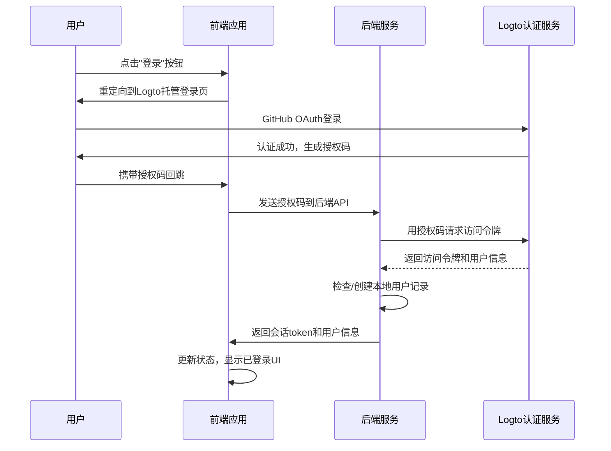

# TOM-199:task:搭建用户认证体系 (Logto)

**模块**: 用户认证与会话管理
**负责人**: Cursor AI
**完成日期**: 2025-01-16

---

## 🔑 【人类任务】任务前置准备清单 (Pre-flight Checklist)
*在将此任务交给AI执行前，指挥官（您）必须手动完成以下工作，并勾选确认。*

- [ ] **Logto服务配置**: 在Logto后台创建新应用，获取App ID、Endpoint等配置信息
- [ ] **GitHub OAuth配置**: 在GitHub Settings中创建OAuth App，获取Client ID和Client Secret
- [ ] **环境变量配置**: 将Logto和GitHub的配置信息填入项目的`.env`文件
  ```env
  LOGTO_ENDPOINT=https://your-logto-instance.com
  LOGTO_APP_ID=your-app-id
  LOGTO_APP_SECRET=your-app-secret
  LOGTO_BASE_URL=http://localhost:3000
  GITHUB_CLIENT_ID=your-github-client-id
  GITHUB_CLIENT_SECRET=your-github-client-secret
  ```
- [ ] **数据库备份**: 在修改User模型前创建数据库备份
- [ ] **依赖安装准备**: 确认需要安装的Logto相关npm包版本
  ```bash
  # 需要安装的包（示例版本）
  npm install @logto/node @logto/client
  ```
- [ ] **开发环境验证**: 确保本地开发环境可以访问Logto服务和GitHub OAuth
- [ ] **回调URL配置**: 在Logto和GitHub后台配置正确的回调URL
  - Logto回调: `http://localhost:3000/auth/callback`
  - GitHub回调: `http://localhost:3000/api/auth/callback`
- [ ] **权限范围确认**: 确认GitHub OAuth需要的权限范围（user:email, read:user）

---

## ⚡ 【AI任务】AI指令包 (AI Instruction Package)
*当所有人类任务完成后，将此部分作为完整的上下文和指令，交给Cursor AI执行。*

### 1. 🎯 核心目标 (Objective)

**Linear Issue**: TOM-199 - 搭建用户认证体系 (Logto)
**核心目标**: 为每一位创作者提供一个安全、独立的"私人灵感库"，通过完整的用户认证体系实现安全的用户身份管理和数据隔离。

**关键价值**: 
- 确保用户的分析卡片和创作素材只属于其个人私人空间
- 提供便捷的GitHub OAuth登录体验，符合开发者用户习惯
- 建立可扩展的认证架构，为后续功能开发奠定基础

### 2. 📝 需求与用户故事 (Requirements & User Story)

**用户故事**: 
作为一名**独立开发者/内容创作者**，我希望能够安全地注册和登录我自己的账户，以便于我可以将我的分析卡片和脚本框架，保存在一个只属于我的私人空间里，而不用担心数据丢失或被他人看到。

**功能需求清单**:
- [ ] 用户能够通过导航栏的"登录/注册"按钮，进入认证页面
- [ ] 优先支持GitHub第三方认证，提供快速注册/登录选项
- [ ] 登录后，导航栏应能显示用户的头像和名称
- [ ] 用户可以从头像下拉菜单中，找到并点击"登出"按钮
- [ ] 登出后，用户应被重定向到产品首页
- [ ] 未登录用户，无法访问需要认证的"我的工作台"或"卡片详情页"

### 3. 🛠️ 技术规格与约束 (Technical Specs & Constraints)

**必须遵循的技术约束**:
- **认证服务**: 必须使用Logto作为核心认证服务
- **登录方式**: MVP阶段优先实现GitHub OAuth登录
- **状态管理**: 必须扩展现有的Zustand user-store，不能重写
- **数据库**: 必须扩展现有User模型，添加logtoId字段
- **UI组件**: 必须使用项目现有的shadcn/ui组件库
- **路由保护**: 使用Next.js 13+ App Router中间件模式

**性能和质量要求**:
- 认证检查响应时间 < 100ms
- 测试覆盖率 ≥ 80%（核心认证逻辑）
- TypeScript strict mode，所有类型严格定义
- 错误处理覆盖所有认证异常场景

### 4. コード 关键代码上下文 (Relevant Code Context)

**现有代码结构**:
```
10-baokuan-jieqouqi-web/
├── src/stores/user-store.ts     # 现有用户状态管理（需扩展）
├── src/lib/api-client.ts        # 现有API客户端（需验证接口）
├── src/lib/utils.ts             # 工具函数库
├── src/components/ui/           # 现有UI组件库
├── prisma/schema.prisma         # 现有User模型（需扩展）
└── src/app/                     # Next.js App Router结构
```

**现有User模型**:
```prisma
model User {
  id          String   @id @default(uuid())
  email       String?  @unique
  phoneNumber String?  @unique
  name        String?
  image       String?
  createdAt   DateTime @default(now())
  sources     AnalysisSource[]
}
```

**现有UserState接口**:
```typescript
interface UserState {
  user: { id: string; email: string } | null
  token: string | null
  setUser: (user: { id: string; email: string } | null) => void
  setToken: (token: string | null) => void
  logout: () => void
}
```

### 5. ✅ 验收标准 (Acceptance Criteria)

**核心功能验收**:
- [ ] 未登录用户访问`/dashboard`时，自动重定向到Logto登录页面
- [ ] 用户在Logto托管UI上成功完成GitHub登录后，被正确回跳到应用，并能看到"我的工作台"页面
- [ ] 前端状态管理器中，用户的登录状态（`isAuthenticated`）和用户信息（`user`）被正确更新和持久化
- [ ] 用户点击"登出"按钮后，前端状态被清空，并被安全地重定向到首页
- [ ] 后端数据库中的 `users` 表，成功创建了对应的用户记录，包含logtoId字段

**UI交互验收**:
- [ ] 导航栏在未登录时显示"登录/注册"按钮
- [ ] 导航栏在登录后显示用户头像和名称
- [ ] 用户头像下拉菜单包含"登出"选项
- [ ] 页面刷新后，登录状态正确恢复
- [ ] 所有认证相关的加载状态有适当的UI反馈

**技术质量验收**:
- [ ] 所有新增TypeScript类型严格定义，无any类型
- [ ] 核心认证逻辑单元测试覆盖率 ≥ 80%
- [ ] `pnpm run build` 无错误无警告
- [ ] 认证中间件性能：页面保护检查 < 100ms
- [ ] 数据库迁移成功，新字段正确添加

### 6. 🧠 执行计划 (Execution Plan)

**执行步骤优先级**:

**Phase 1: 基础设施（最高优先级）**
1. **数据库模型扩展**
   - 在User模型中添加`logtoId: String? @unique`和`updatedAt: DateTime @updatedAt`
   - 生成并执行数据库迁移
   - 验证迁移成功

2. **认证服务核心**
   - 创建`src/lib/logto-client.ts`配置Logto客户端
   - 创建`src/lib/auth-service.ts`实现认证核心逻辑
   - 实现token处理、用户信息获取、回调处理等方法

**Phase 2: 状态管理和API（高优先级）**
3. **状态管理扩展**
   - 扩展`src/stores/user-store.ts`，添加`isAuthenticated`、`isLoading`字段
   - 实现`login`、`refreshUser`、`initializeAuth`方法
   - 确保与现有方法的完全兼容

4. **API路由实现**
   - 创建`src/app/api/auth/callback/route.ts`处理认证回调
   - 创建`src/app/api/auth/me/route.ts`获取用户信息
   - 创建`src/app/api/auth/logout/route.ts`处理登出
   - 实现用户数据同步逻辑（Logto → 本地数据库）

**Phase 3: 路由保护和UI（高优先级）**
5. **路由保护中间件**
   - 创建`src/middleware.ts`实现认证检查
   - 配置保护路径（/dashboard, /workspace等）
   - 处理未认证用户的重定向逻辑

6. **认证组件开发**
   - 创建`src/components/auth/AuthButton.tsx`
   - 创建`src/components/auth/UserAvatar.tsx`
   - 创建`src/components/auth/ProfileDropdown.tsx`
   - 创建`src/components/auth/AuthGuard.tsx`

**Phase 4: 页面集成和测试（中等优先级）**
7. **页面实现**
   - 创建`src/app/auth/callback/page.tsx`
   - 创建`src/app/dashboard/page.tsx`
   - 集成认证组件到现有导航栏

8. **测试实现**
   - 编写认证服务单元测试
   - 编写状态管理测试用例
   - 编写API路由集成测试

### 7. 🔗 相关知识 (Relevant Knowledge)

**关键技术参考**:
- **Logto文档**: [https://docs.logto.io/](https://docs.logto.io/)
- **Next.js 13+ 中间件**: [https://nextjs.org/docs/app/building-your-application/routing/middleware](https://nextjs.org/docs/app/building-your-application/routing/middleware)
- **Zustand状态管理**: [https://github.com/pmndrs/zustand](https://github.com/pmndrs/zustand)
- **Prisma迁移**: [https://www.prisma.io/docs/concepts/components/prisma-migrate](https://www.prisma.io/docs/concepts/components/prisma-migrate)

**认证流程时序图**:


**常见问题预防**:
1. **接口依赖错误**: 执行前必须使用`grep_search`验证现有服务接口
2. **状态同步问题**: 确保前端状态与后端session完全一致
3. **类型定义不匹配**: Logto用户信息与本地User类型必须完全对应
4. **路由保护遗漏**: 所有需要认证的页面路径都要在中间件中配置

**重要提醒**:
- 在开始实现前，必须验证人类任务清单中的所有配置已完成
- 实现过程中如遇到配置问题，应暂停并要求人类确认配置
- 测试时使用真实的Logto环境，不要mock核心认证流程 