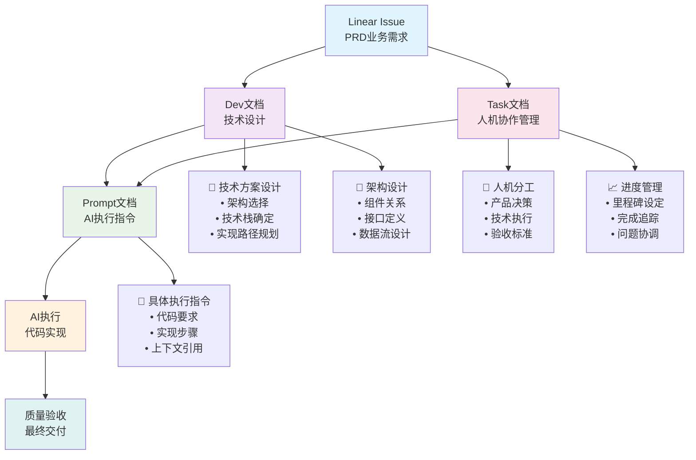

# 文档体系设计指南

> **核心理念**: 先设计方案，再执行实现，最后管理协作

---

## 📋 概述 (Overview)

本文档体系基于**独立开发**和**vibe coding**模式设计，通过三个文档规则实现从需求到交付的完整流程：

- **🎯 Dev文档**: 技术设计和方案规划
- **🤖 Prompt文档**: AI执行指令和实现要求  
- **👥 Task文档**: 人机协作管理和验收协调

---

## 🔄 文档流程 (Document Workflow)



---

## 📚 三大文档规则详解

### 🎯 Dev文档 - 技术设计规划

**文件位置**: `.cursor/rules/230-wf-write-dev-docs.mdc`
**输出路径**: `docs/development/[Task-ID]-dev-[title].md`

#### 核心定位
- **阶段**: 设计阶段（接收Linear Issue后的第一步）
- **职责**: 技术方案设计、架构规划、实现路径分析
- **输出**: 为Prompt文档提供技术设计基础
- **用时**: 30-60分钟深度技术分析

#### 主要内容
1. **🎯 设计概述**
   - 设计目标和技术范围
   - 核心设计决策和原则
   - 设计输出和交付物

2. **🏗️ 技术架构**
   - 技术栈选择和理由
   - 架构模式和设计模式
   - 组件关系和接口定义

3. **📋 实现规划**
   - 具体实现步骤
   - 开发里程碑
   - 风险评估和应对策略

4. **🔧 质量标准**
   - 代码质量要求
   - 性能基准
   - 测试覆盖标准

#### 关键特点
- ✅ **设计导向**: 专注于技术方案设计，不是实现记录
- ✅ **架构重点**: 强调系统架构和技术选择
- ✅ **基础作用**: 为Prompt文档提供技术设计基础
- ✅ **风险意识**: 前置风险分析和应对策略

---

### 🤖 Prompt文档 - AI执行指令

**文件位置**: `.cursor/rules/250-wf-prompt-engineering.mdc`
**输出路径**: `docs/prompts/[Task-ID].prompt.[title].md`

#### 核心定位
- **阶段**: 执行阶段（基于Dev文档生成AI指令）
- **职责**: 将技术设计转化为AI可执行的具体指令
- **输出**: 确保AI准确理解和执行技术方案
- **用时**: 20-30分钟指令编写

#### 主要内容
1. **🎯 目标定义**
   - 基于Dev文档的执行目标
   - 明确的验收标准
   - 具体的成功指标

2. **📋 上下文引用**
   - 关键文件的@引用路径
   - 依赖服务的接口验证
   - 现有代码的调用示例

3. **🔧 实现要求**
   - 具体的技术约束
   - 详细的代码结构
   - 类型定义和接口规范

4. **🔄 执行步骤**
   - 分阶段的实现步骤
   - 优先级和依赖关系
   - 检查清单和验证点

#### 关键特点
- ✅ **执行导向**: 专注于AI的具体执行指令
- ✅ **上下文完整**: 提供充分的代码上下文和引用
- ✅ **步骤明确**: 详细的实现步骤和验证标准
- ✅ **质量保证**: 完整的检查清单和错误预防

---

### 👥 Task文档 - 人机协作管理

**文件位置**: `.cursor/rules/231-wf-write-task-docs.mdc`
**输出路径**: `docs/tasks/[Task-ID]-task-[title].md`

#### 核心定位
- **阶段**: 产品规划阶段（基于Linear Issue直接生成）
- **职责**: 从产品角度确定人机分工、验收标准、进度管理
- **输出**: 为整个项目提供协作框架和验收基准
- **用时**: 5-10分钟快速决策

#### 主要内容
1. **🎯 快速决策摘要**
   - 业务优先级和核心价值
   - 技术方案和时间预估
   - 主要风险和应对策略

2. **🔑 人机分工清单**
   - 人类负责的战略决策
   - AI负责的执行任务
   - 明确的协作界限

3. **📦 AI指令包**
   - 简洁的执行目标
   - 关键的技术约束
   - 明确的验收标准

4. **📈 执行记录**
   - 时间和进度记录
   - 关键决策记录
   - 完成确认清单

#### 关键特点
- ✅ **轻量级**: 5-10分钟完成，适合独立开发
- ✅ **分工明确**: 清晰的人机协作界限
- ✅ **管理导向**: 专注于协作和进度管理
- ✅ **决策支持**: 快速的业务和技术决策

---

## 🚀 使用指南 (Usage Guide)

### 📋 标准流程

1. **📥 接收Linear Issue**
   - 理解业务需求和验收标准
   - 识别技术挑战和关键风险

2. **🎯 创建Dev文档 + 👥 创建Task文档（并行）**
   ```bash
   # 基于Linear Issue创建技术设计文档
   AI: 根据@Linear-Issue-Link 创建 [Task-ID]-dev-[title].md
   
   # 基于Linear Issue创建人机协作管理文档
   AI: 根据@Linear-Issue-Link 创建 [Task-ID]-task-[title].md
   ```
   
   **Dev文档**:
   - 完成技术方案设计
   - 确定架构和实现路径
   - 评估风险和制定应对策略
   
   **Task文档**:
   - 明确人机分工界限
   - 设定协作和验收标准
   - 建立进度跟踪机制

3. **🤖 生成Prompt文档**
   ```bash
   # 基于Dev文档和Task文档生成AI执行指令
   AI: 根据@[Task-ID]-dev-[title].md 和@[Task-ID]-task-[title].md 创建 [Task-ID].prompt.[title].md
   ```
   - 将技术设计转化为AI指令
   - 结合Task文档的验收标准
   - 确保指令的完整性和准确性

4. **⚡ AI执行实现**
   ```bash
   # 基于Prompt文档执行实现
   AI: 根据@[Task-ID].prompt.[title].md 执行技术实现
   ```
   - 按照Prompt指令执行代码实现
   - 遵循Dev文档的技术设计
   - 完成Task文档的验收标准

### ⚠️ 注意事项

1. **文档依赖关系**
   - Linear Issue → Dev文档（技术设计）+ Task文档（协作管理）
   - Dev文档 + Task文档 → Prompt文档（执行指令）
   - Task文档和Dev文档是并行创建的，都基于Linear Issue

2. **职责边界**
   - Dev文档：技术设计，不涉及具体实现
   - Prompt文档：执行指令，不涉及技术决策
   - Task文档：协作管理，不涉及技术细节

3. **质量保证**
   - 每个文档都有明确的检查清单
   - 确保文档间的一致性和连贯性
   - 定期回顾和优化文档质量

---

## 💡 最佳实践 (Best Practices)

### 🎯 Dev文档最佳实践

1. **技术决策记录**
   - 记录为什么选择某种技术方案
   - 分析不同方案的优缺点
   - 考虑未来的扩展性和维护性

2. **架构设计原则**
   - 保持架构的简洁性和可理解性
   - 考虑系统的可测试性和可维护性
   - 预留未来功能扩展的接口

3. **风险评估方法**
   - 识别技术风险、性能风险、集成风险
   - 为每个风险制定具体的应对策略
   - 考虑风险的概率和影响程度

### 🤖 Prompt文档最佳实践

1. **上下文引用规范**
   - 使用@符号引用具体文件路径
   - 验证所有依赖服务的接口
   - 提供充分的代码示例和说明

2. **指令明确性**
   - 使用具体的技术术语
   - 避免模糊的表述和要求
   - 提供可测试的验收标准

3. **错误预防机制**
   - 基于历史经验预防常见错误
   - 添加接口依赖检查清单
   - 强调类型安全和边界条件

### 👥 Task文档最佳实践

1. **快速决策支持**
   - 专注于必须由人类做的决策
   - 避免技术细节的重复描述
   - 保持文档的轻量级和高效性

2. **人机分工明确**
   - 清晰定义人类和AI的职责边界
   - 避免职责重叠和模糊地带
   - 建立有效的协作机制

3. **进度管理有效**
   - 设定明确的里程碑和检查点
   - 建立问题上报和解决机制
   - 保持项目进度的可视化

---

## 📊 效果评估 (Effectiveness Evaluation)

### 🎯 成功指标

1. **文档质量指标**
   - Dev文档的技术方案完整性 ≥ 95%
   - Prompt文档的执行成功率 ≥ 90%
   - Task文档的协作效率提升 ≥ 50%

2. **开发效率指标**
   - 从需求到设计的时间 ≤ 1小时
   - AI执行的准确率 ≥ 85%
   - 整体交付周期缩短 ≥ 30%

3. **质量保证指标**
   - 技术债务减少 ≥ 40%
   - 代码质量评分 ≥ 4.0/5.0
   - 用户满意度 ≥ 90%

### 🔄 持续改进

1. **文档模板优化**
   - 根据使用反馈调整模板结构
   - 更新最佳实践和示例
   - 完善错误处理和边界情况

2. **流程流畅度提升**
   - 简化文档间的依赖关系
   - 优化AI执行的准确性
   - 提高人机协作的效率

3. **知识管理建设**
   - 建立文档质量评估机制
   - 形成最佳实践知识库
   - 持续培训和经验分享

---

## 🔗 相关资源 (Related Resources)

### 📁 文档规则文件
- **Dev文档规则**: `.cursor/rules/230-wf-write-dev-docs.mdc`
- **Prompt文档规则**: `.cursor/rules/250-wf-prompt-engineering.mdc`
- **Task文档规则**: `.cursor/rules/231-wf-write-task-docs.mdc`

### 📂 输出目录结构
```
docs/
├── development/          # Dev文档输出目录
│   ├── TOM-XXX-dev-*.md
├── prompts/             # Prompt文档输出目录
│   ├── TOM-XXX.prompt.*.md
├── tasks/               # Task文档输出目录
│   ├── TOM-XXX-task-*.md
└── 文档体系设计指南.md    # 本指南文档
```

### 🛠️ 工具和命令
```bash
# 创建文档命令示例
AI: 根据 Linear Issue TOM-XXX 创建开发文档
AI: 根据 @TOM-XXX-dev-*.md 创建 Prompt 文档  
AI: 创建 TOM-XXX 的任务协作文档

# 文档质量检查
AI: 检查文档的完整性和一致性
AI: 验证文档间的依赖关系
AI: 优化文档的可读性和实用性
```

---

## 🔍 **TOM-201案例：PRD与开发文档审视分析**

### 📋 **项目背景**
- **任务**: TOM-201 - 创建"我的工作台"并实现卡片列表展示
- **PRD来源**: Linear Issue 
- **开发文档**: `docs/development/TOM-201-dev-my-workspace-dashboard.md`
- **分析时间**: 2025-01-03

---

### 🎯 **PRD质量分析**

#### ✅ **优点评价**
1. **结构完整性** ⭐⭐⭐⭐⭐
   - 使用标准PRD模板：目标、用户故事、功能要求、技术约束、验收标准、范围界定
   - 信息层次清晰，易于理解和执行

2. **用户导向性** ⭐⭐⭐⭐⭐
   - 明确的用户故事："作为已登录用户，我希望看到我所有分析报告的页面"
   - 业务价值清晰：构建产品使用闭环，提升用户粘性

3. **功能具体性** ⭐⭐⭐⭐⭐
   - 详细的功能清单，包含UI交互细节
   - 明确的页面路由要求：`/dashboard` 或 `/workspace`
   - 具体的显示内容：源标题、版本标题、创建时间

4. **验收完整性** ⭐⭐⭐⭐⭐
   - 6个具体的验收标准，可测试性强
   - 包含正常流程、异常处理（空状态）、交互功能验证

#### ⚠️ **潜在问题分析**

1. **数据模型不明确** ⭐⭐⭐
   ```markdown
   问题：PRD假设用户直接拥有AnalysisCard
   现实：数据模型是 User -> AnalysisSource -> AnalysisCard
   影响：需要关联查询，增加实现复杂度
   ```

2. **性能要求缺失** ⭐⭐
   ```markdown
   问题：没有明确的性能指标
   建议：应包含页面加载时间、列表响应速度等要求
   ```

3. **国际化考虑不足** ⭐⭐
   ```markdown
   问题：界面文案没有考虑多语言支持
   建议：预留国际化扩展空间
   ```

---

### 🏗️ **开发文档质量分析**

#### ✅ **优点评价**

1. **技术架构清晰** ⭐⭐⭐⭐⭐
   - 明确的技术栈选择：Next.js 14 + Server Components
   - 详细的组件设计和文件结构
   - 清晰的数据流设计

2. **类型定义完善** ⭐⭐⭐⭐⭐
   ```typescript
   type DashboardAnalysisCard = {
     id: string;
     sourceTitle: string;
     versionTitle: string;
     createdAt: Date;
     // ...
   };
   ```

3. **验收标准对应** ⭐⭐⭐⭐⭐
   - 与PRD验收标准一一对应
   - 扩展了技术层面的验收要求

#### ⚠️ **关键问题分析**

1. **数据模型理解错误** ⭐⭐⚠️
   ```markdown
   错误：文档假设直接查询用户的AnalysisCard
   现实：需要通过 User -> sources -> analysisCards 关联查询
   修正：需要更新数据获取策略
   ```

2. **现有代码分析不足** ⭐⭐⭐
   ```markdown
   问题：没有分析现有dashboard页面的冲突
   现状：已存在 /dashboard 页面，功能定位不同
   影响：可能造成功能重复或冲突
   ```

3. **导航集成策略不明确** ⭐⭐⭐
   ```markdown
   问题：UserAvatar组件已有"/dashboard"链接为"个人中心"
   需求：PRD要求是"我的工作台"
   方案：需要明确导航重构策略
   ```

---

### 🔍 **深度技术分析**

#### **数据库查询策略修正**
```typescript
// ❌ 开发文档中的错误假设
const getUserCards = (userId: string) => {
  return prisma.analysisCard.findMany({
    where: { userId } // 此字段不存在
  });
};

// ✅ 正确的查询策略
const getUserCards = (userId: string) => {
  return prisma.user.findUnique({
    where: { id: userId },
    include: {
      sources: {
        include: {
          analysisCards: {
            orderBy: { createdAt: 'desc' }
          }
        }
      }
    }
  });
};
```

#### **现有代码冲突分析**
```typescript
// 现有 /dashboard 页面：用户信息展示
// 新需求：工作台卡片列表

// 解决方案1：重构现有dashboard
// 解决方案2：使用 /workspace 路由
// 解决方案3：合并两个功能
```

#### **导航集成策略**
```typescript
// 当前 UserAvatar 组件
<DropdownMenuItem asChild>
  <a href="/dashboard" className="cursor-pointer">
    <User className="mr-2 h-4 w-4" />
    <span>个人中心</span>  {/* 与PRD不符 */}
  </a>
</DropdownMenuItem>

// 建议修正
<DropdownMenuItem asChild>
  <a href="/dashboard" className="cursor-pointer">
    <LayoutDashboard className="mr-2 h-4 w-4" />
    <span>我的工作台</span>  {/* 符合PRD要求 */}
  </a>
</DropdownMenuItem>
```

---

### 📊 **质量评分总结**

| 维度 | PRD评分 | 开发文档评分 | 说明 |
|------|---------|-------------|------|
| **完整性** | ⭐⭐⭐⭐⭐ | ⭐⭐⭐⭐ | PRD完整，开发文档缺少现有代码分析 |
| **准确性** | ⭐⭐⭐⭐ | ⭐⭐⭐ | PRD准确，开发文档有数据模型理解错误 |
| **可执行性** | ⭐⭐⭐⭐ | ⭐⭐⭐ | 都具备可执行性，但需要技术修正 |
| **风险意识** | ⭐⭐⭐ | ⭐⭐⭐⭐ | PRD缺少技术风险，开发文档风险评估较好 |
| **可维护性** | ⭐⭐⭐⭐ | ⭐⭐⭐⭐⭐ | 开发文档在可维护性设计方面更优 |

**综合评分**: PRD ⭐⭐⭐⭐ | 开发文档 ⭐⭐⭐⭐

---

### 🚀 **改进建议**

#### **PRD优化建议**
1. **补充数据模型说明**
   - 明确AnalysisCard与用户的关系模型
   - 添加数据量和性能考虑

2. **增加性能要求**
   - 页面加载时间 < 1.5s
   - 列表渲染性能要求
   - 大数据量处理策略

#### **开发文档修正建议**
1. **修正数据获取策略**
   ```typescript
   // 正确的用户卡片获取逻辑
   const getAnalysisCardsByUserId = async (userId: string) => {
     const userWithCards = await prisma.user.findUnique({
       where: { id: userId },
       include: {
         sources: {
           include: {
             analysisCards: true
           }
         }
       }
     });
     
     return userWithCards?.sources.flatMap(source => 
       source.analysisCards.map(card => ({
         ...card,
         sourceTitle: source.title
       }))
     ) || [];
   };
   ```

2. **解决现有代码冲突**
   - 分析现有dashboard页面功能
   - 制定重构或合并策略
   - 更新导航组件的链接文案

3. **补充实现风险评估**
   - 大数据量渲染性能风险
   - 用户权限验证风险
   - 现有功能兼容性风险

---

### 💡 **经验总结**

#### **文档协作改进点**
1. **PRD阶段应包含**：
   - 基础的数据模型说明
   - 现有功能影响分析
   - 基本的性能要求

2. **开发文档阶段应加强**：
   - 现有代码库深度分析
   - 数据模型准确理解
   - 潜在冲突预先识别

3. **质量检查机制**：
   - PRD与现有系统一致性检查
   - 开发文档与实际代码对比验证
   - 跨文档信息一致性校验

#### **最佳实践提炼**
1. **设计阶段**：深入理解现有架构再做设计
2. **文档阶段**：多角度验证技术方案的准确性  
3. **实施阶段**：基于准确的技术分析进行开发

**结论**: 本次分析揭示了PRD和开发文档在质量和准确性方面的具体问题，为后续的文档体系优化提供了实际案例和改进方向。

---

**📝 文档版本**: v2.1  
**🔄 最后更新**: 2025-01-03  
**👤 维护者**: Cursor AI + 独立开发者

---

> **💡 使用提示**: 本文档体系专为独立开发和vibe coding模式设计，重点关注效率和质量的平衡。建议将此文档作为Obsidian笔记保存，便于快速查阅和更新。 